# Rapport de Test Visuel — Application Asoro

*Généré le 17/10/2026 12:33:03*

Ce dossier regroupe les captures d'écran réelles issues des tests automatiques sur l'ensemble des écrans et fonctionnalités de l'application Asoro.

| N° | Écran | Description | Fichier de capture |
| --- | --- | --- | --- |
| 1 | **Page d'accueil (Visiteur)** | Présentation de l'application Asoro, promesse de valeur, aperçu du bilan et boutons de démarrage. | [01_accueil.png](./01_accueil.png) |
| 2 | **Inscription utilisateur** | Formulaire d'inscription avec validation en direct du mot de passe fort (majuscule, minuscule, chiffre, symbole, 6 caractères min). | [02_inscription.png](./02_inscription.png) |
| 3 | **Connexion utilisateur** | Formulaire de connexion épuré avec gestion des erreurs sans divulgation et lien mot de passe oublié. | [03_connexion.png](./03_connexion.png) |
| 4 | **Mot de passe oublié** | Écran de récupération de compte par email sécurisé. | [04_mot_de_passe_oublie.png](./04_mot_de_passe_oublie.png) |
| 5 | **Tableau de bord (Dashboard)** | Vue principale : solde du mois disponible, double jauge dépensé/gagné du jour et de la semaine, liste des 5 dernières opérations. | [05_tableau_de_bord.png](./05_tableau_de_bord.png) |
| 6 | **Saisie rapide (Quick Add)** | Tiroir d'ajout rapide en 5 secondes avec pavé tactile numérique 12 touches, sélecteur de mode (Dépense / Revenu / Prêt) et catégories. | [06_saisie_rapide.png](./06_saisie_rapide.png) |
| 7 | **Dépenses prévues & Règlements** | Suivi des dépenses budgétées : barres de progression, règlements partiels et statuts (À venir, En cours, Soldée, Dépassée). | [07_depenses_prevues.png](./07_depenses_prevues.png) |
| 8 | **Finances, Salaires & Prêts** | Gestion du salaire mensuel récurrent, revenus exceptionnels, dettes et créances avec calcul instantané du net. | [08_finances_et_prets.png](./08_finances_et_prets.png) |
| 9 | **Bilan & Analyse financière** | Bilan périodique (Jour, Semaine, Mois) : solde net, moyenne disponible par jour, graphique d'évolution et répartition par catégorie. | [09_bilan.png](./09_bilan.png) |
| 10 | **Historique des opérations** | Journal chronologique groupé par jour, totaux quotidiens, filtres (Tout, Dépenses, Revenus, Prêts) et suppression avec confirmation. | [10_historique.png](./10_historique.png) |
| 11 | **Profil & Paramètres** | Choix de la devise (FCFA, EUR, USD), bascule de thème clair/sombre, option 'Solde figé à minuit', déconnexion et suppression sécurisée. | [11_profil.png](./11_profil.png) |
| 12 | **Tableau de bord — Thème sombre** | Rendu optimal et contrasté du thème sombre conforme à la maquette et aux critères WCAG AA. | [12_mode_sombre.png](./12_mode_sombre.png) |

---

## Détails des écrans testés

### 1. Page d'accueil (Visiteur)
> Présentation de l'application Asoro, promesse de valeur, aperçu du bilan et boutons de démarrage.

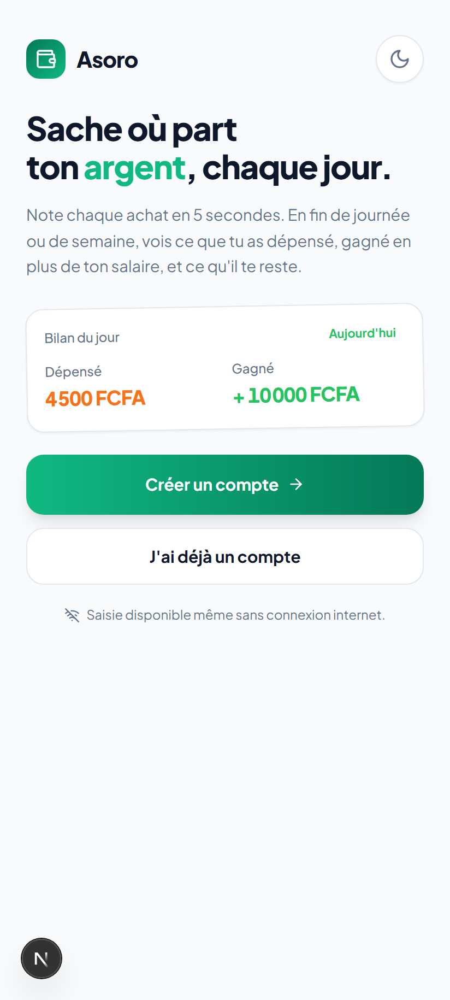

### 2. Inscription utilisateur
> Formulaire d'inscription avec validation en direct du mot de passe fort (majuscule, minuscule, chiffre, symbole, 6 caractères min).

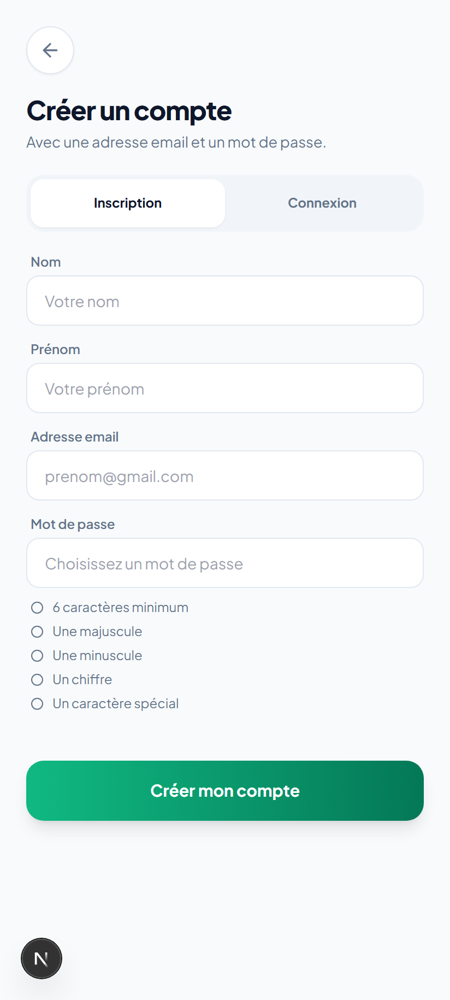

### 3. Connexion utilisateur
> Formulaire de connexion épuré avec gestion des erreurs sans divulgation et lien mot de passe oublié.

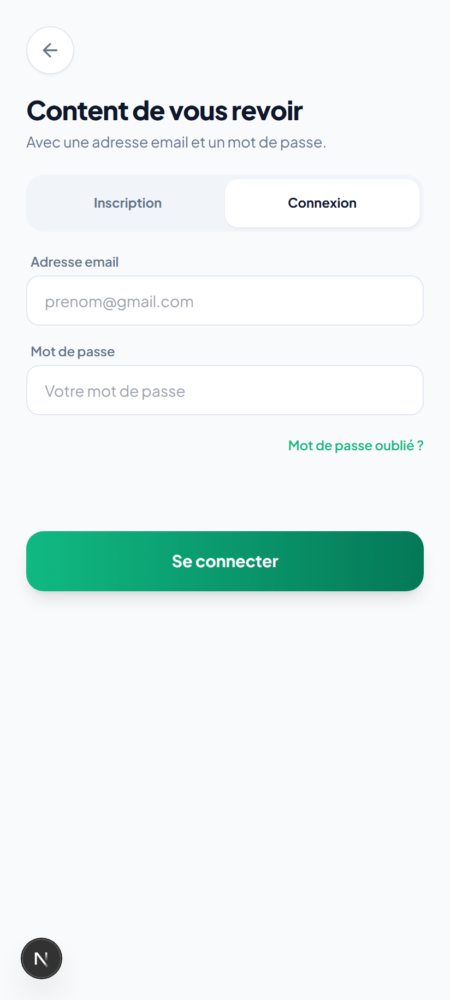

### 4. Mot de passe oublié
> Écran de récupération de compte par email sécurisé.

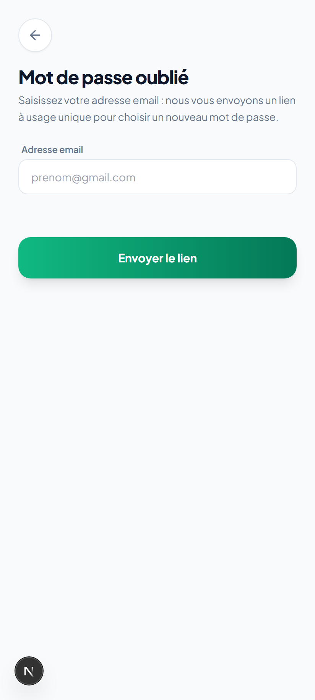

### 5. Tableau de bord (Dashboard)
> Vue principale : solde du mois disponible, double jauge dépensé/gagné du jour et de la semaine, liste des 5 dernières opérations.

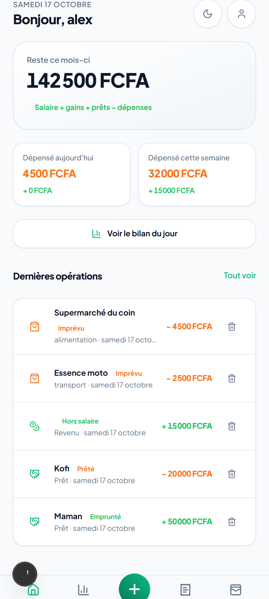

### 6. Saisie rapide (Quick Add)
> Tiroir d'ajout rapide en 5 secondes avec pavé tactile numérique 12 touches, sélecteur de mode (Dépense / Revenu / Prêt) et catégories.

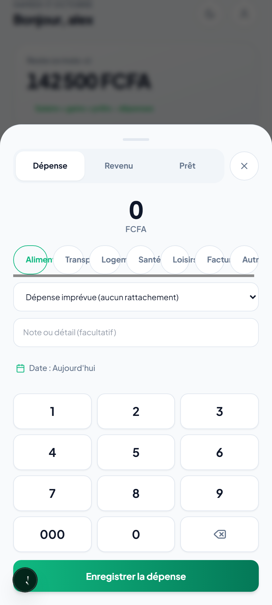

### 7. Dépenses prévues & Règlements
> Suivi des dépenses budgétées : barres de progression, règlements partiels et statuts (À venir, En cours, Soldée, Dépassée).

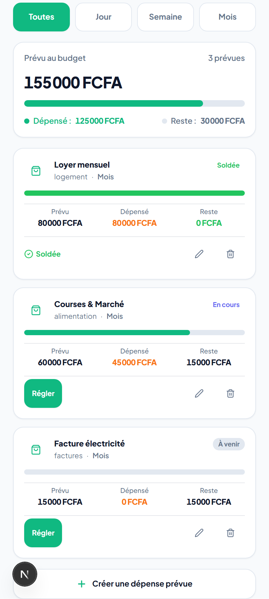

### 8. Finances, Salaires & Prêts
> Gestion du salaire mensuel récurrent, revenus exceptionnels, dettes et créances avec calcul instantané du net.

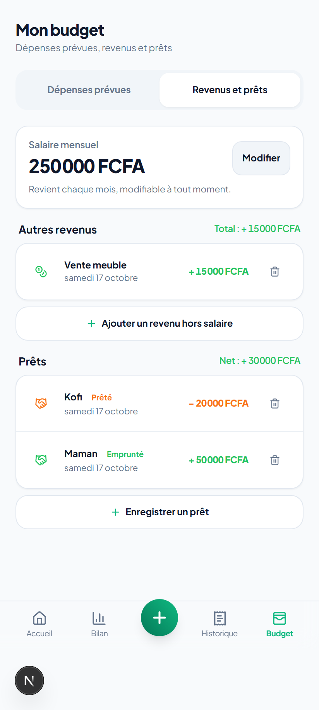

### 9. Bilan & Analyse financière
> Bilan périodique (Jour, Semaine, Mois) : solde net, moyenne disponible par jour, graphique d'évolution et répartition par catégorie.

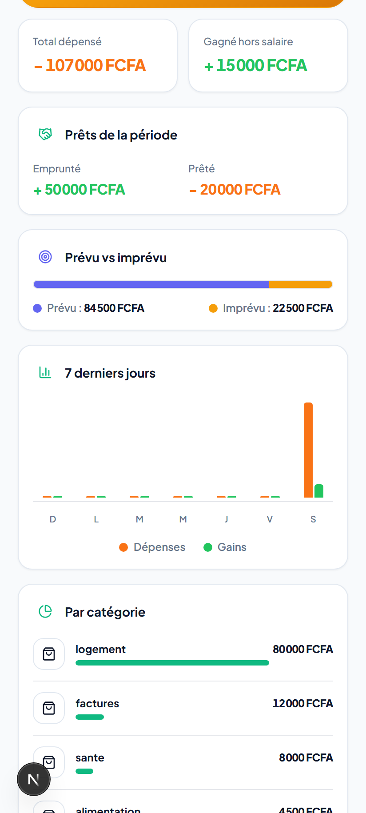

### 10. Historique des opérations
> Journal chronologique groupé par jour, totaux quotidiens, filtres (Tout, Dépenses, Revenus, Prêts) et suppression avec confirmation.

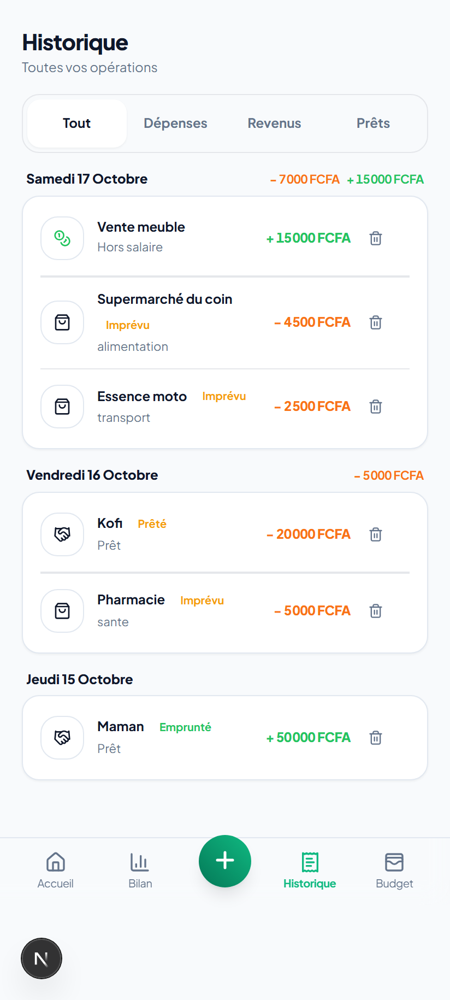

### 11. Profil & Paramètres
> Choix de la devise (FCFA, EUR, USD), bascule de thème clair/sombre, option 'Solde figé à minuit', déconnexion et suppression sécurisée.

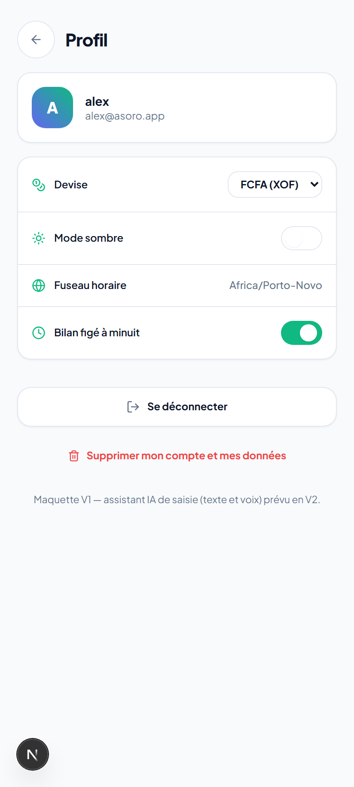

### 12. Tableau de bord — Thème sombre
> Rendu optimal et contrasté du thème sombre conforme à la maquette et aux critères WCAG AA.

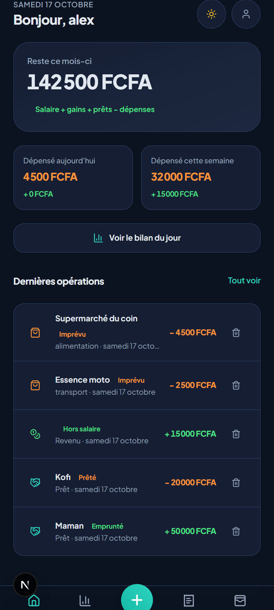

